<div align="center">

<h1><br>Lotwise</h1>

### Position Terminal: Trading Risk Calculator

**Calculate exact lot size, risk, and reward for Forex, Synthetic Indices, Crypto & Real Indices with live prices, alarms, and PWA install.**

[](https://nextjs.org)
[](https://www.typescriptlang.org)
[](https://tailwindcss.com)
[](https://web.dev/progressive-web-apps/)

[](LICENSE)
[]()

</div>

---

<div align="center">


*Risk-first position sizing and trade journal for Forex, Deriv synthetic indices, real indices, and crypto.*

</div>

---

## 📋 Table of Contents

- [Overview](#-overview)
- [Features](#-features)
- [Live Price Feeds](#-live-price-feeds)
- [Screenshots](#-screenshots)
- [Tech Stack](#-tech-stack)
- [Quick Start](#-quick-start)
- [Deploy Your Own](#-deploy-your-own)
- [Project Structure](#-project-structure)
- [Disclaimer](#-disclaimer)
- [License](#-license)

---

## 🎯 Overview

**Lotwise** is a browser-based trading position calculator. The calculator and trade journal run on your device; live prices and chart embeds connect to third-party providers. No Lotwise account or application server is required. Enter your balance, risk percentage, and trade setup to calculate a position size, estimated loss and profit, and risk-to-reward ratio, with broker minimum-lot validation.

### Why Lotwise?

| Traditional Calculators | Lotwise |
|---|---|
| Static formulas, no live prices | **Real-time price feeds** from Binance, Deriv & TradingView |
| Manual lot size entry | **Auto-calculated exact lot** based on your risk % |
| No broker minimum check | **Min-lot validation** with adjusted scenario warnings |
| No alerts | **Sound alarms + browser notifications** for entry/SL/TP hits |
| No trade journal | **Built-in journal + equity curve** with win-rate tracking |
| Web only | **Installable PWA**: works offline, launches like a native app |
| Risk capped at 1-3% | **Adjustable 0.5%–100%** with high-risk warnings |

---

## Features

### 📊 Position Calculator
- **160 trading symbols** across 4 asset classes: 35 forex, 46 synthetic indices currently listed by Deriv's public market feed, 16 real indices, and 63 crypto symbols
- **Exact lot size** auto-calculated from your risk percentage and SL distance
- **Min-lot validation**: warns when calculated lot is below broker minimum, shows adjusted scenario
- **Risk-to-reward visualizer**: color-coded bar showing SL zone (red), entry marker (gold), TP zone (green)
- **0.5%–100% risk slider** with quick presets (1%, 2%, 5%, 10%, 25%, 50%, 100%)
- **Multi-currency display**: switch between USD, EUR, GBP, NGN, JPY

### 📈 Live Price Feeds
- **Crypto**: Prices from Binance REST API (63 catalog symbols; availability depends on Binance market listings)
- **Forex**: Real-time prices from TradingView Scanner API (EUR/USD, GBP/USD, 35 pairs)
- **Indices**: Real-time prices from TradingView Scanner API (US30, NAS100, DAX, 16 indices)
- **Synthetic**: Deriv's public WebSocket market-data API for 46 currently listed Boom, Crash, Volatility, Jump, Step, Range Break, and basket indices
- **One-click price fill**: "Fill Live Entry" auto-populates the entry field

### 🕯️ Candlestick Charts
- **TradingView widget** for Forex, Indices & Crypto (with symbol search + drawing tools)
- **Custom candlestick chart** for Synthetic indices (TradingView Lightweight Charts + Deriv candles API)
- **6 timeframes**: 1m, 5m, 15m, 1h, 4h, 1D
- **Volume histogram** + crosshair + live price overlay

### 🔔 Alarm & Notification System
- **Auto-detect** when live price hits your entry, stop loss, or take profit
- **4 distinct sound profiles** (synthesized via Web Audio API: no audio files):
  - 🎯 Entry: C-E-G major triad ascending
  - 🛑 Stop Loss: A-F-C descending sawtooth
  - 📈 Take Profit: C-E-G-C octave arpeggio
  - 🔔 Custom: E-A perfect fifth
- **Custom price alerts**: set any target price with "crosses above" or "crosses below" direction
- **Browser notifications** with OS-level alerts, including Web Push while the installed app is closed
- **Scheduled background monitoring** for active alerts and open journal trades; Netlify checks about once per minute, so short crossings can occur between checks
- **Adjustable volume** + per-event-type toggles
- **Preview button** to test each alarm before relying on it

### 📝 Trade Journal & Equity Curve
- **Save trades** with journal notes (up to 200 characters)
- **Automatic outcomes**: live feed price crossings record win/loss, exit price, close time, and estimated realized P/L; outcomes can also be edited manually
- **Equity curve chart**: SVG-based, includes completed trades only and orders them by close time
- **Win-rate statistics**: recorded trades, wins, win rate %
- **Replay function**: reload any saved trade's exact parameters
- **localStorage persistence**: survives page refresh

### 📱 PWA: Install as a Native App
- **Installable** on desktop (Chrome/Edge) and mobile (Chrome/Safari)
- **Standalone window**: no browser chrome
- **Offline shell**: service worker caches the UI for instant load
- **Background push alerts** through a scheduled Netlify Function; enable browser notifications in the alarm panel and configure VAPID keys on self-hosted Netlify deployments
- **App shortcuts**: quick-access to Synthetic, Forex, or Crypto tabs
- **Custom icons**: 192px, 512px, maskable, Apple touch icon, favicon

### 🔍 Searchable Symbol Picker
- **Type-to-filter** across all sub-categories simultaneously
- **Grouped display** when browsing (Majors, EUR Crosses, Volatility Indices, etc.)
- **LIVE badge** on every synthetic symbol with Deriv feed
- **Active indicator** on currently selected symbol

### ⚖️ Legal & Compliance
- **Terms of Service** (10 sections covering service nature, no financial advice, risk disclosure)
- **Privacy Policy** (9 sections: privacy-first, no tracking, localStorage only)
- **Risk Disclaimer** (10 sections + problem gambling help links)

---

## 🔴 Live Price Feeds

| Asset Class | Source | Status | Pairs |
|---|---|---|---|
| **Crypto** | Binance REST API | ✅ Real-time (no key needed) | 63 catalog symbols |
| **Forex** | TradingView Scanner API | ✅ Real-time (no key needed) | 35 |
| **Indices** | TradingView Scanner API | ✅ Real-time (no key needed) | 16 |
| **Synthetic** | Deriv WebSocket API | ⚠️ Requires non-blocked IP | 48 |

> **Note on Synthetic Indices**: The browser connects directly to Deriv's public, no-auth market-data WebSocket. The current endpoint returned real quotes and candles during project verification. If a visitor's network blocks Deriv, the app clearly labels the fallback as simulated and disables live-only journal closure and alerts. Browser push alerts can run while the app is closed after notifications are enabled; the Netlify monitor checks prices about once per minute, so this is not a continuous tick stream and can miss brief crossings between checks.

---

## 📸 Screenshots

### Desktop: Position Calculator with Live Candlestick Chart
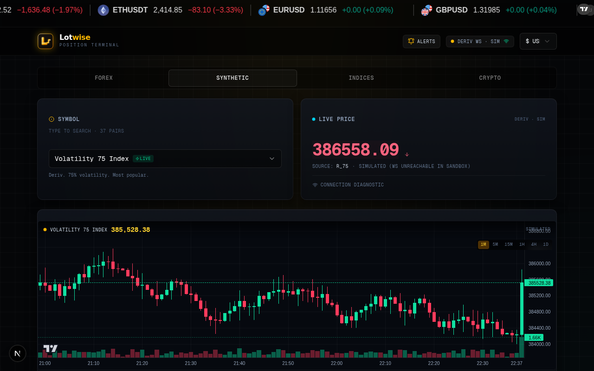

### Calculation Output: Lot Size, Risk:Reward, Stats
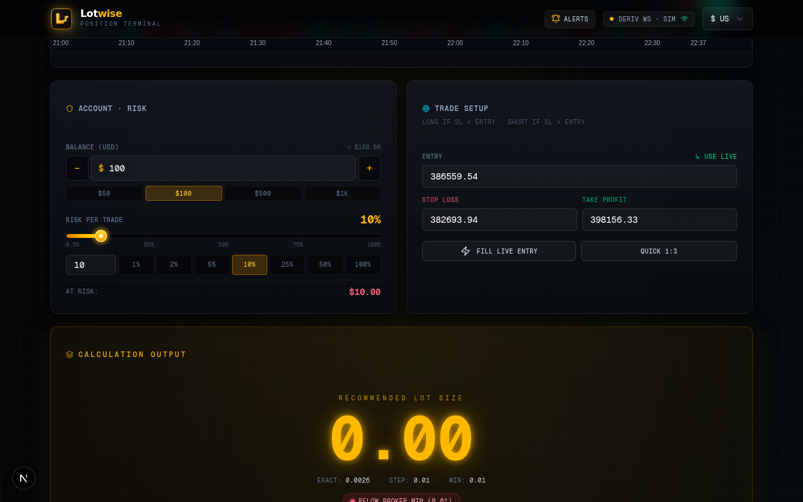

### Risk:Reward Visual Bar + Min-Lot Warning
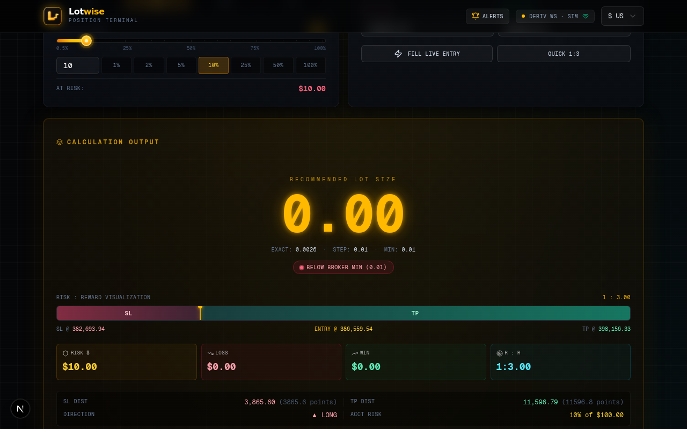

### Crypto: Real Binance Live Prices
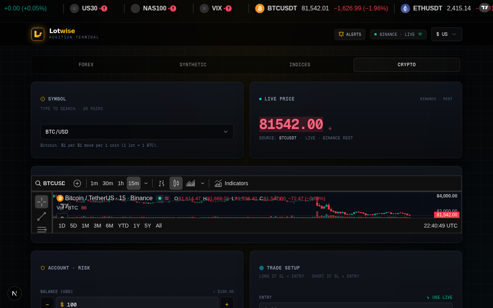

### Crypto Position Calculation
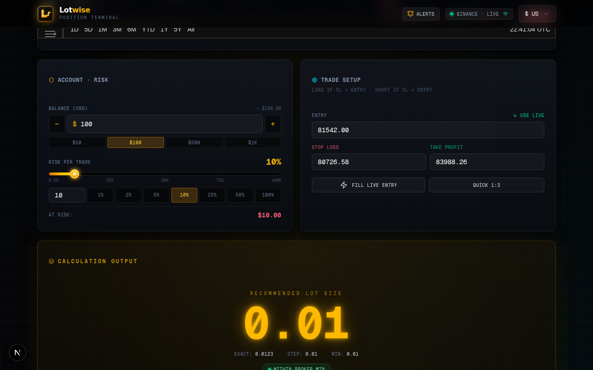

### Forex: Real EUR/USD Live Price
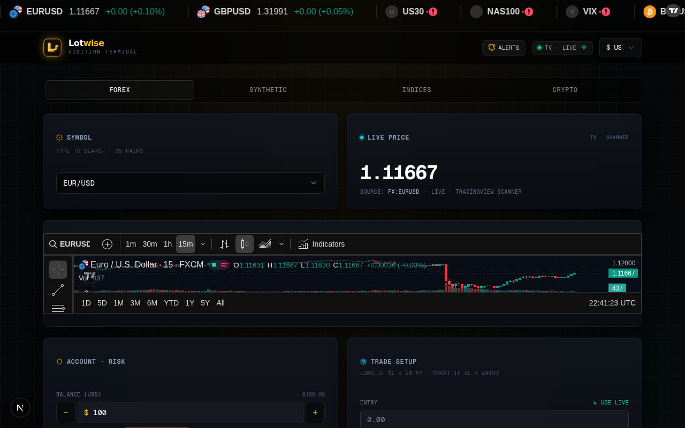

### Alarm & Notification Panel
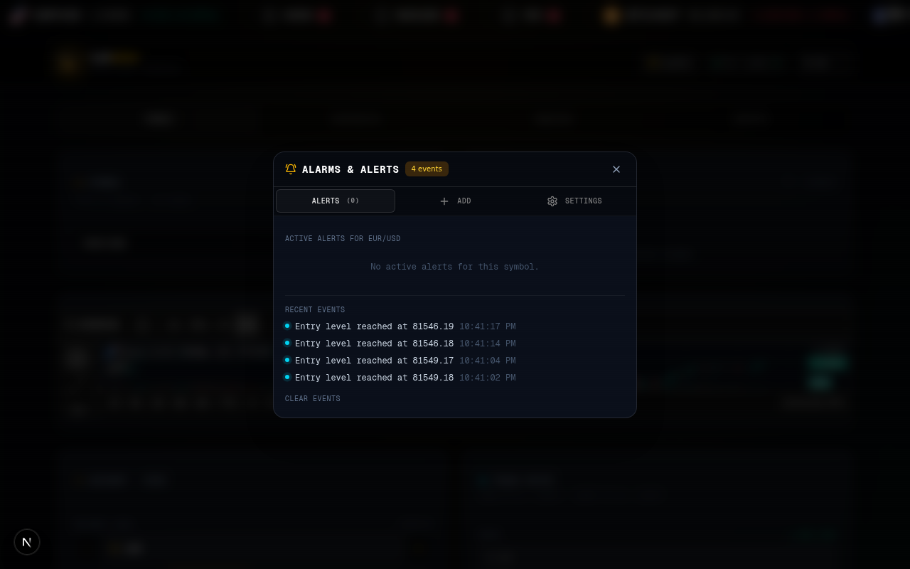

### Alarm Settings: Sound Profiles + Volume
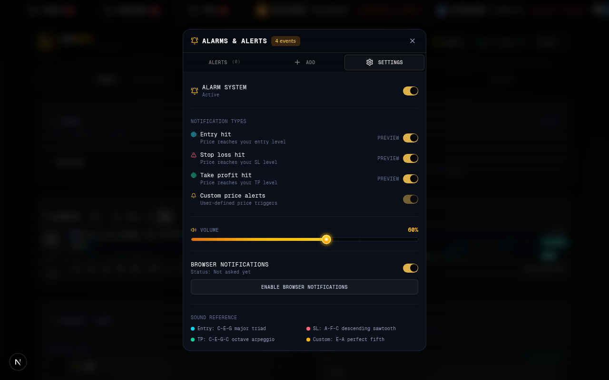

### Equity Curve + Trade Journal
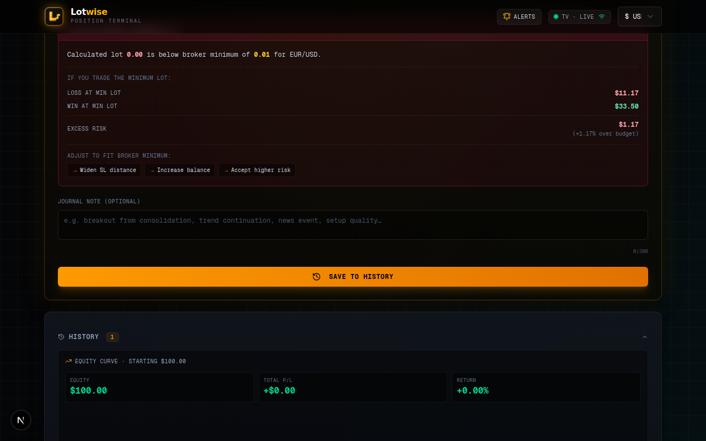

### Legal Modal: Terms of Service
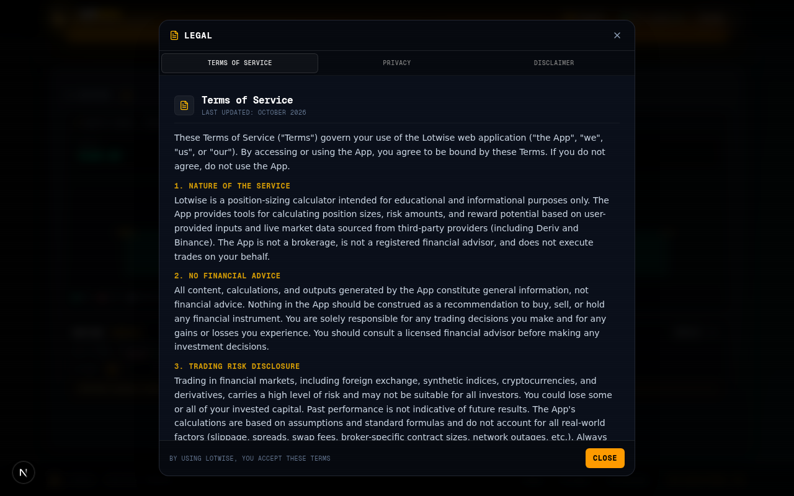

### Mobile: Full Responsive Layout
<p float="left">
  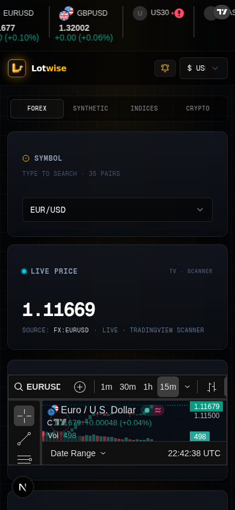
  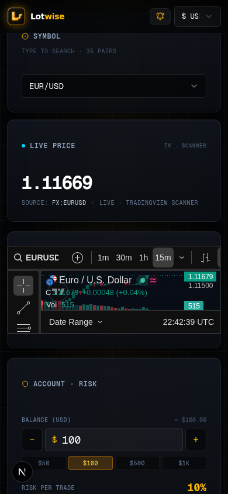
</p>

---

## 🛠 Tech Stack

| Layer | Technology |
|---|---|
| **Framework** | Next.js 16 (App Router, Turbopack) |
| **Language** | TypeScript 5 (strict mode) |
| **Styling** | Tailwind CSS 4 + custom terminal aesthetic |
| **UI Components** | shadcn/ui (New York style) + Radix UI primitives |
| **Charts** | TradingView Lightweight Charts v5 + custom SVG equity curve |
| **Live Prices** | Binance REST API + TradingView Scanner API + Deriv WebSocket |
| **Sound** | Web Audio API (synthesized tones, no audio files) |
| **PWA** | Service Worker + Web App Manifest + custom icons |
| **Notifications** | Browser Notification API + Service Worker push |
| **Storage** | localStorage (no backend, no database, no tracking) |
| **Icons** | Lucide React |

---

## 🚀 Quick Start

### Prerequisites
- [Node.js](https://nodejs.org/) 20.9 or later
- A modern browser with WebSocket support
- [Bun](https://bun.sh/) only if you want to run the optional price relay

### Installation

```bash
# Clone the repository
git clone https://github.com/BboyGT/lotwise.git
cd lotwise

# Install the exact dependency versions in the lockfile
npm ci

# Start the dev server
npm run dev
```

Open [http://localhost:3000](http://localhost:3000) in your browser.

The app does not require environment variables for local development. Browser price feeds connect directly to their providers. Netlify background push monitoring uses `VAPID_PUBLIC_KEY`, `VAPID_PRIVATE_KEY`, and `VAPID_SUBJECT` environment variables. Keep the private VAPID key in Netlify's secret environment variables; never commit it. An optional Deriv WebSocket-to-HTTP relay is available for local integrations:

```bash
npm run dev:relay
```

To run the app and relay together, use `npm run dev:all` (requires Bun). The calculator and direct price feeds work without the relay.

### Build for Production

```bash
npm run build
npm run start
```

### Lint & Type Check

```bash
npm run lint          # ESLint
npm run typecheck     # TypeScript type checking
npm test              # Calculator unit tests (Vitest)
```

The calculator is a pure function (`src/lib/calculator.ts`) and is covered by unit tests in `tests/`. For USD-base forex pairs (USD/JPY, USD/CHF, USD/CAD and the USD exotics) the pip value is derived from your entry price, so lot sizes stay correct as the rate moves.

## Continuous integration and releases

GitHub Actions runs linting, TypeScript checks, tests, and a production build on pushes and pull requests to `main`, using Node.js 20 and 22. CodeQL scans the JavaScript and TypeScript code, and Dependabot checks npm dependencies and GitHub Actions weekly. Test output is retained in the workflow run logs; temporary local tool captures are intentionally not versioned.

To publish a GitHub Release and container image, update the version in `package.json` and `package-lock.json`, then push a matching version tag such as `v1.1.0`. The release workflow reruns CI, creates release notes, and publishes a Docker image to GitHub Container Registry (`ghcr.io`). Lotwise is an application, not an npm library.

---

## 🌐 Deploy Your Own

### Vercel (Recommended: Free)
1. Push this repo to GitHub
2. Go to [vercel.com](https://vercel.com) → Import Project
3. Select your repo → Deploy
4. Done! Your app is live with HTTPS (required for PWA)

> **Market data**: Deriv prices are requested directly by each visitor's browser from Deriv's public WebSocket. The hosting provider does not turn simulated prices into live prices; the visitor's network must allow the Deriv connection.

### Netlify
1. Push to GitHub
2. Go to [netlify.com](https://netlify.com) → Add new site → Import from Git
3. Build command: `npm run build` (already set in `netlify.toml`)
4. Use the detected Next.js runtime with build command `npm run build` and publish directory `.next`
5. Deploy

### Local Development
```bash
npm run dev
# Open http://localhost:3000
# Live prices require the browser to reach the provider's public endpoint.
```

### Register Your Own Deriv App ID (Optional)
The current public market-data endpoint requires no app ID. Register an app ID only if you choose to use the legacy WebSocket fallback:
1. Go to [api.deriv.com](https://api.deriv.com) → Register
2. Create a new app (free, takes 2 minutes)
3. Replace the legacy fallback's `app_id=1089` value in the two Deriv hooks

---

## 📁 Project Structure

```
lotwise/
├── src/
│   ├── app/
│   │   ├── layout.tsx          # Root layout + PWA meta tags
│   │   ├── page.tsx            # Main app (calculator UI)
│   │   └── globals-mark.css   # Terminal theme + custom styles
│   ├── components/
│   │   ├── alarm-panel.tsx           # Alarm/alerts UI (3 tabs)
│   │   ├── connection-diagnostic.tsx  # WS reachability tester
│   │   ├── equity-curve-chart.tsx     # SVG equity curve + win rate
│   │   ├── gt-mark.tsx                # Author badge
│   │   ├── legal-modal.tsx            # Terms/Privacy/Disclaimer
│   │   ├── lotwise-logo.tsx          # Brand SVG logo
│   │   ├── searchable-symbol-picker.tsx  # Type-to-filter combobox
│   │   ├── synthetic-candle-chart.tsx     # Candlestick chart for synthetics
│   │   ├── tradingview-widget.tsx    # TradingView embed widgets
│   │   └── ui/                        # shadcn/ui components
│   ├── hooks/
│   │   ├── use-alarm-manager.ts       # Alarm detection + sound + notifications
│   │   ├── use-deriv-candles-v2.ts    # Deriv candle stream + simulator
│   │   ├── use-live-price-v3.ts       # Multi-source live price hook
│   │   ├── use-pwa.ts                # PWA install + SW registration
│   │   └── use-toast.ts              # Toast notifications
│   └── lib/
│       ├── calculator.ts              # Position sizing engine
│       ├── sound-engine.ts            # Web Audio synthesized tones
│       └── symbols-v3.ts             # Symbol specs + contract data
├── mini-services/price-relay/     # Optional Bun service bridging Deriv WS to REST
├── tests/                         # Vitest unit tests
├── public/
│   ├── logo.svg                # Brand logo
│   ├── manifest.json           # PWA manifest
│   ├── sw.js                   # Service worker
│   ├── icon-192.png            # PWA icons (6 variants)
│   └── icon-512.png
└── package.json
```

---

## 📊 Supported Symbols (160 Total)

### Forex (35 pairs)
- **Majors** (7): EUR/USD, GBP/USD, USD/JPY, USD/CHF, USD/CAD, AUD/USD, NZD/USD
- **EUR Crosses** (6): EUR/GBP, EUR/JPY, EUR/CHF, EUR/AUD, EUR/CAD, EUR/NZD
- **GBP Crosses** (5): GBP/JPY, GBP/CHF, GBP/AUD, GBP/CAD, GBP/NZD
- **AUD Crosses** (4): AUD/JPY, AUD/CHF, AUD/CAD, AUD/NZD
- **NZD Crosses** (3): NZD/JPY, NZD/CHF, NZD/CAD
- **Other Crosses** (2): CHF/JPY, CAD/JPY
- **Exotics** (8): USD/MXN, USD/ZAR, USD/TRY, USD/SGD, USD/HKD, USD/SEK, USD/NOK, USD/DKK

### Synthetic Indices (46 symbols)
- **Boom & Crash** (14): Boom 50/150/300/500/600/900/1000, Crash 50/150/300/500/600/900/1000
- **Volatility** (5): V10, V25, V50, V75, V100
- **Volatility 1s** (8): V10, V15, V25, V30, V50, V75, V90, V100 (1s)
- **Jump** (5): Jump 10/25/50/75/100
- **Step** (5): Step 100/200/300/400/500
- **Bull/Bear** (2): Bull Market, Bear Market
- **Range Break** (2): Range Break 100/200
- **Baskets** (5): AUD, EUR, GBP, USD, and Gold

### Real Indices (16 pairs)
- **US** (4): US30, NAS100, S&P 500, Russell 2000
- **Europe** (7): GER40 (DAX), UK100 (FTSE), FRA40 (CAC), ESP35, ITA40, NETH25, SWISS20
- **Asia** (4): JPN225 (Nikkei), HKG50 (Hang Seng), AUS200 (ASX), KOSPI 200
- **Volatility** (1): VIX

### Crypto (63 symbols)
- **Major** (8): BTC, ETH, XRP, SOL, ADA, DOT, LTC, BCH
- **Layer 1 & 2** (10): AVAX, ATOM, NEAR, ARB, OP, APT, MATIC, FIL, INJ, SUI
- **DeFi & Oracles** (15): LINK, UNI, AAVE, MKR, RUNE, TIA, SEI, BNB, DYDX, CRV, SUSHI, YFI, COMP, SNX, 1INCH
- **Layer 1 Additional** (8): TRX, ETC, XLM, VET, ALGO, ICP, EGLD, STX
- **Gaming & NFT** (7): SAND, MANA, AXS, GALA, THETA, CHZ, ENJ
- **Meme Coins** (5): DOGE, SHIB, PEPE, BONK, WIF
- **AI & Infrastructure** (5): RNDR, GRT, LDO, ORDI, WLD
- **Additional** (5): FTM, ZIL, FLOW, IOTA, JUP

---

## ⚖️ Disclaimer

**Lotwise is for educational purposes only.** It is not financial advice. Trading forex, synthetic indices, cryptocurrencies, and derivatives carries substantial risk of loss. You could lose all of your invested capital. Never trade with money you cannot afford to lose.

All calculations are based on standard retail broker formulas and may differ from your broker's actual execution due to spreads, slippage, swap fees, and broker-specific contract sizes. Always verify calculations independently before placing a trade.

See the in-app **Disclaimer** tab (footer link) for the full risk disclosure.

---

## 📄 License

This project is licensed under the MIT License: see the [LICENSE](LICENSE) file for details.

---

<div align="center">

**Built with [Next.js](https://nextjs.org) · [TradingView Lightweight Charts](https://www.tradingview.com/lightweight-charts/) · [Binance API](https://binance-docs.github.io/apidocs/) · [Deriv API](https://api.deriv.com)**

<br>

**If this project helped you, give it a ⭐**

</div>
